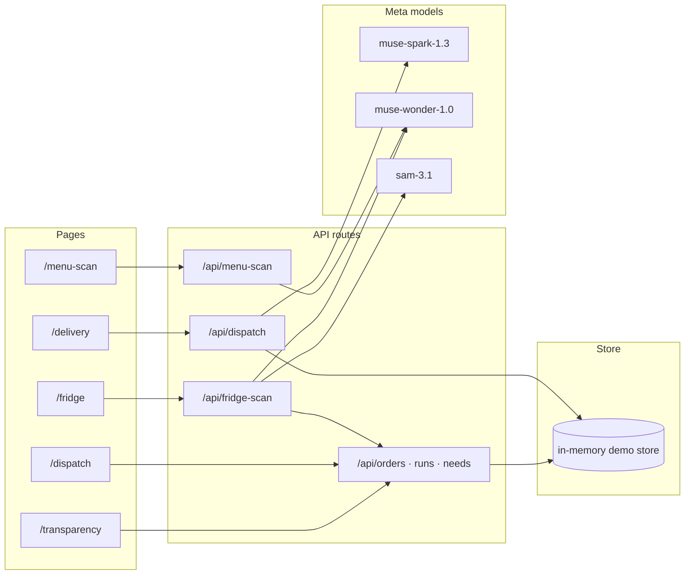

# Strongo


Community-run food delivery and neighborhood services — owned by the
community, not by an app taking 30%.

Built for the Meta Global AI Developer Hackathon 2026 · Indie track ·
Build for Your World.

## The problem, in numbers

- Delivery platforms take up to **30% commission** from local restaurants,
  plus service fees and delivery fees stacked on the customer.
- Drivers see opaque, algorithmic pay with no say in how the system runs.
- Neighbors who need food, tools, or help have no shared board — and no
  shared delivery network — to turn to after hours.

Strongo replaces the extractive middleman with community-owned tooling:
plain-words ordering, an AI dispatcher, open books, and a need board —
plus experimental Labs (gardens, hubs, simulators) for everything else a
neighborhood shares.

## How it fits together



## Meta models used

| Model | Where | What it does |
|-------|-------|--------------|
| muse-spark-1.3 | `/api/dispatch`, `/api/garden-coach` | Plain-words order dispatcher (multilingual), garden coach |
| muse-wonder-1.0 | `/api/menu-scan`, `/api/fridge-scan` | Paper-menu transcription, fridge inventory + staples gaps |
| sam-3.1 | `/api/fridge-scan` | Item outlines overlaid on fridge photos (fail-soft) |

Every AI result shows a badge with the model name and server-measured
latency in ms. Without a key, the dispatcher runs a labeled local
fallback so the demo never breaks.

## Quickstart

Requirements: Node 20+ and npm.

```sh
npm install
npm run dev
```

Then open [http://localhost:3000](http://localhost:3000) in your browser.

AI features need a Meta Model API key from
[dev.meta.ai](https://dev.meta.ai):

```sh
cp .env.example .env.local   # add MODEL_API_KEY
```

On Vercel, add `MODEL_API_KEY` as an environment variable and deploy
with the Next.js preset (`npm run build`).

### Docker

```sh
cp .env.example .env.local   # add MODEL_API_KEY for AI features (optional)
docker compose up --build
```

Then open [http://localhost:3000](http://localhost:3000) in your browser.
The image is multi-stage (Node 20) running the Next.js standalone server.

### Eval and tests

```sh
npm run dev &          # eval needs a live server
EVAL_BASE_URL=http://localhost:3000 npm run eval
npm test               # vitest: 21 tests
```

Eval results (20 orders, varied budgets/cuisines/diets, 4 non-English —
run against the local fallback, 0/20 via AI):

- Full pass (menu match + budget): **20/20 (100%)**
- Budget adherence: 18/18 · Real menu matches: 20/20
- Median server latency: 0ms

Full table: [eval/results.md](eval/results.md). CI runs typecheck, tests,
and build on every push and pull request.

## Screenshots

| Page | Shot |
|------|------|
| Landing | `docs/screenshots/landing.png` (todo) |
| Delivery order flow | `docs/screenshots/delivery.png` (todo) |
| Dispatch driver view | `docs/screenshots/dispatch.png` (todo) |
| Fridge check + SAM outlines | `docs/screenshots/fridge.png` (todo) |
| Transparency open books | `docs/screenshots/transparency.png` (todo) |

## Demo script (3-minute video)

Sample scan inputs live in [`demo-assets/`](demo-assets/): `menu.webp`
for `/menu-scan`, `fridge.jpg` for `/fridge`.

1. Land on `/` — the pitch: delivery without the 30% cut.
2. `/delivery` — order in plain words (try the Spanish chip); note the
   model + latency badge on the suggestion.
3. `/dispatch` — accept the run as a driver, advance it to delivered.
4. `/transparency` — show where every dollar went.
5. `/fridge` — scan a fridge photo, see SAM outlines + low-on list,
   post to the need board.
6. `/labs` — pan the roadmap: gardens, hubs, simulators.

## Core loop

- `/delivery` — order flow with an AI dispatcher (plain-words ordering).
- `/menu-scan` — photograph a paper menu, AI transcribes it.
- `/dispatch` — driver view: accept and advance deliveries.
- `/transparency` — open books: where every dollar goes.
- `/fridge` — community fridge inventory with need-board posting.
- `/map` — pilot-neighborhood map of restaurants and drivers.

## Labs (roadmap)

Experimental pages under [/labs](/labs), one line each:

- `/garden` — yard-to-garden planner: crops, effort, yield, tools.
- `/plotter` — drag-and-drop garden bed planner with sun + yield.
- `/hubs` — community hubs map, directory, and 24/7 night board.
- `/simulate` — livestock rotation and dog-corridor simulators.
- `/pilot` — Portland pilot map with customer/driver views.
- `/lab` — map overlay playground with dev panel (simulated demand).

## Layout

- `app/` — pages above, plus `provenance.tsx` (hackathon footer).
- `app/api/` — `orders`, `dispatch`, `menu-scan`, `fridge-scan`,
  `garden`, `garden-coach`, `needs`, `runs`, `parcels`, `health`.
- `lib/meta.ts` — Meta Model API client (chat + vision).
- `lib/sam.ts` — SAM 3.1 segmentation via the Responses API.
- `lib/store.ts` — in-memory demo store and seed data.
- `lib/garden.ts` — crop database and garden planner.
- `lib/hubs.ts` — hub directory and need board.
- `lib/simulate.ts` — livestock and corridor math.
- `lib/portland.ts` — Portland pilot seeds (demo data).
- `eval/dispatch-eval.ts` — 20-order dispatcher eval.
- `tests/` — vitest suites for the lib modules.
- `app/research/` — research index plus one route per doc.
- `docs/` — research Markdown, the source of truth.
- `AGENTS.md` — repo conventions. `BUILD-LOG.md` — build log.

## Docs

- [Community needs](docs/needs.md)
- [Food delivery, without the cut](docs/food-delivery.md)
- [Roadmap](docs/roadmap.md)

Read them on the site under Research, or right here on GitHub.
